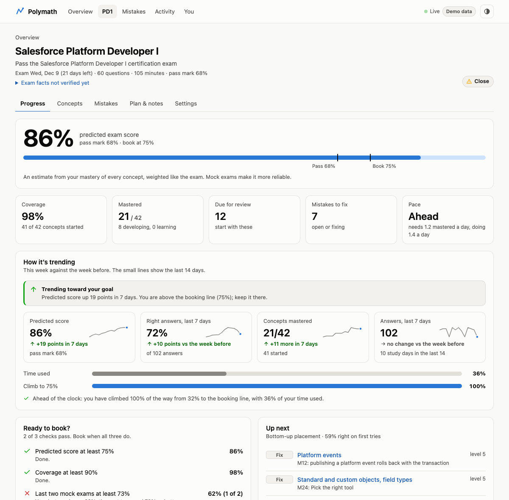

# Polymath

**A personal AI tutor that learns how you answer.** Tell Claude what you want to learn,
whether it's a certification, a programming language or a whole field. It asks questions
first, adapts to every answer, and teaches you from your mistakes rather than from a
script. It remembers what you know, what you got wrong and what you are about to forget,
across weeks and across goals.

- **Questions first, lessons only where you need them.** It probes what you already know,
  skips what you've got, and teaches the exact belief behind each wrong answer.
- **Adapts to how you answer.**
  - Difficulty steps up after confident hits and down after misses.
  - Strong first answers switch it to top-down probing: advanced concepts first, and a
    hard question answered well credits the concepts underneath.
  - Beginners get a short primer before each new idea.
- **A mistake bank.** Every real miss is logged, re-asked in a new form until you get it,
  and checked again a day later. Slips and trick-question traps are tracked separately,
  as exam technique.
- **Many goals, one memory.** Salesforce Platform Developer I, then PD2 and the architect
  exams, then a Claude certification. Concepts are shared, so what you master for PD1
  already counts for PD2.
- **Honest readiness.** Mastery per concept, a predicted exam score against the pass
  mark, pace against your target date, and mock exams.
- **Plan any goal in a conversation.** Say "I want the Salesforce CTA". It researches the official
  prerequisites, asks what you already have, finds your gaps and builds a dated roadmap.
- **Click a term, read it in depth.** After you answer, key terms open a sourced lesson inline.
- **Interview prep.** Add a job, your resume and who you're meeting. It researches the company and the
  interviewers' public work, finds your gaps, predicts the questions and coaches your answers.
- **Honest time.** Only time you are actually using the app counts.
- **A live dashboard** that shows whether you are trending toward your exam or away from
  it: this week against last, where your pace leads by the exam date, right answers over
  time, and time used against progress made.
- **Study in the browser too.** The same question-first sessions, quizzes, timed mock
  exams and a study coach run in the dashboard, with questions written by Claude Code on
  your subscription. Answers land in the same files, so you can switch between the
  browser and Claude Code freely.
- **Your data, on your machine.** Plain files in `~/.polymath`. No account, no cloud
  service, no API key beyond your Claude subscription. The dashboard is a small server
  you run yourself.

## What a session looks like

```
you   > /polymath:learn salesforce-pd1
Sage  > Morning, Sam. 2 open mistakes, 61 days to your PD1 target, readiness 58%
        against a 68% pass mark. First, your open mistake on Database methods:
        A batch inserts 200 Contacts with Database.insert(records, false); 3 fail
        validation. What happens to the other 197? Answer and how sure you are (1-5).
you   > all 200 roll back. 4
Sage  > ✗ That's the belief from last week again: with allOrNone=false, the 197 valid
        records are saved and the 3 failures come back in the SaveResult list. Only
        allOrNone=true (the DML-statement default) rolls back everything.
        Same rule, new case: an upsert of 50 Accounts with Database.upsert(list, ext, false),
        and 2 have a bad external id. How many are saved?
you   > 48. 5
Sage  > ✓ Right. M3 is fixing; I'll check it again tomorrow. Next: a probe on Platform
        Cache. You're answering at expert level, so this one is hard...
```

## Install

You need:
- [Python](https://www.python.org/downloads/) 3.9 or later.
- A working AI model. **Polymath works best with [Claude Code](https://claude.com/claude-code)**, signed in with an active
  Claude subscription. Study uses your plan's usage. Ollama, LM Studio and API keys also work, but other models can
  write wrong answers more often.

The installer checks your models first. If none passes, it stops and installs nothing. If one or more pass, it asks
you to confirm your default.

**Mac or Linux.** Open Terminal and run:

```
curl -fsSL https://raw.githubusercontent.com/ipowerai/polymath/main/install.sh | bash
```

**Windows.** Open PowerShell and run:

```
irm https://raw.githubusercontent.com/ipowerai/polymath/main/install.ps1 | iex
```

It installs for your account only, starts when you log in, and opens in your browser at
`http://127.0.0.1:8765`. If that port is busy it picks the next free one. To choose a port,
add `-s -- --port 9000` after `bash`, or on Windows first run `$env:POLYMATH_PORT = 9000`.
To remove it, run the command the installer prints. Your study data stays in `~/.polymath`.

Control it from the terminal:

```
polymath status    # is it running, and where
polymath start     # start it, and keep it starting at login
polymath stop      # stop it, and keep it off until you start it
polymath restart   # stop it and start it again
polymath open      # open it in your browser
```

### Use it inside Claude Code too

Add the marketplace and install the plugin:

```
/plugin marketplace add ipowerai/polymath
/plugin install polymath@polymath
```

To use a local clone without publishing it:

```
claude plugin marketplace add /path/to/polymath
claude plugin install polymath@polymath
# or, for a single session: claude --plugin-dir /path/to/polymath
```

Then type `/polymath:learn` and say what you want to learn.

**Permissions.** The tutor records every answer by running its engine,
`scripts/polymath.py`. The first time it does so in a session, Claude Code asks for your
permission. Choose the option that stops asking for that command, and answers are
recorded without interruption from then on. The engine writes only inside your Polymath
data folder (`~/.polymath`).

## Commands

| Command | What it does |
| --- | --- |
| `/polymath:learn [goal or topic]` | Set up a goal, or continue. A question-first session that adapts to every answer. |
| `/polymath:review` | Fix open mistakes first, then a spaced-repetition review of everything due. |
| `/polymath:quiz [track, area or concept] [n]` | An adaptive practice quiz, with optional rapid-fire blocks. |
| `/polymath:mock-exam [track] [mini\|full]` | A timed exam, weighted by the exam blueprint. Every miss becomes a mistake to fix. |
| `/polymath:progress [track]` | Readiness, mastery by area, mistakes, pace and exam technique, and offers to open the live dashboard. |
| `/polymath:coach [concern]` | Reads your mistake patterns and pace, and adjusts the plan and dates. |

You can also just talk: "quiz me on async Apex", "am I ready to book the exam?", "I'm
falling behind" all trigger the right skill.

## The dashboard



```
python3 scripts/polymath.py serve --open      # opens its sign-in link, http://127.0.0.1:8765/?token=…
python3 scripts/polymath.py serve --demo      # preview it with a simulated learner (no sign-in)
```

Run these from the plugin folder, or ask for it in Claude Code with `/polymath:progress`.

The dashboard reads the same files the tutor writes, so it updates as you answer. For
every goal it shows:
- the predicted score against the pass mark, and which way it is trending this week;
- where that pace leads by your exam date;
- right answers over time, and concepts mastered against the pace you need;
- mastery by area, the booking checks, your mistakes, study days and sessions.

From the page you can also set an exam date, log a mock exam taken elsewhere, add notes,
or void a question whose answer key was wrong.

### Study in the dashboard

The **Study** page runs learn sessions, reviews, quizzes and timed mock exams in the
browser, plus a coach you can talk to about your plan. It follows the same method as
`/polymath:learn`:
- you answer first;
- after a confident miss it asks what made you pick that answer;
- it teaches from the belief behind the miss;
- it re-asks the rule in a new case, once a separate check has confirmed the question
  and its key;
- it re-checks today's fixes before the session ends.

Claude Code writes the questions, run with no tools, no MCP servers and no project
access, on your subscription, under a daily cap you set. A block of three takes about
20 to 50 seconds to write, and the next block is written while you answer. With
`--demo`, built-in practice questions stand in, so you can try it with no AI at all.
What is sent to Claude, and how its work is checked, is in
[docs/DASHBOARD.md](docs/DASHBOARD.md#study-in-the-browser).

Polymath works best with Claude. You can also use a model on your computer or an API key.
Change it any time on the [AI model](docs/DASHBOARD.md#ai-model) tab.

It signs you in with a private token, on this machine too, because study spends your
Claude usage and other accounts on the machine can reach it: open the link it prints
once. It also runs anywhere else: on your network, on a server or in Docker, or you can
reach it through an SSH tunnel or Tailscale. See [docs/DASHBOARD.md](docs/DASHBOARD.md). `polymath.py dashboard` writes the
same page as one self-contained file instead.

## How it works

Polymath splits the job in two:

- **Claude asks and teaches.** The skills give it a tutor persona and a question-first
  method: probe, grade honestly, find the belief behind a wrong answer, refute it with a
  contrasting case, and ask again in a new form. Spacing, interleaving and confidence
  ratings do the rest.
- **A small engine keeps score and steers.**
  [`scripts/polymath.py`](scripts/polymath.py) is standard-library Python with no
  dependencies.
  - Every graded answer goes into an append-only event log, and everything else is
    recomputed from it: mastery per concept (Bayesian Knowledge Tracing), memory decay and
    review dates, the mistake bank, your placement, pace, memory and calibration, exam
    readiness, and a finish-date projection.
  - Each answer comes back with a **signal** (solid, fragile, gap, misconception, slip,
    trap) and an **action** (advance, confirm, fill the gap, teach, refute, check
    prerequisites, technique), plus the next difficulty. The adaptation is therefore
    consistent, not left to the model's mood.

The details, with formulas, are in [docs/HOW-IT-WORKS.md](docs/HOW-IT-WORKS.md).

## Your data

```
~/.polymath/
  learner.json      preferences: session length, starting level, block size, tutor name and tone
  learner.md        the tutor's notes on how you learn (edit freely)
  events.jsonl      every answer, lesson, session and mock exam (the source of truth)
  concepts.json     every concept you have studied, shared across tracks
  tracks/<slug>/    track.json, syllabus.json, plan.md, notes.md (disputed.jsonl: keys found wrong)
  journal/          a dated log of each session
  dashboard.html    a snapshot of the dashboard (polymath.py dashboard)
  web-token         the dashboard's sign-in token (private to you; never commit it)
  web-auth.json     the browsers signed in to the dashboard (hashes, not the sign-ins themselves)
  web-ping-key      a random key that lets a second start recognise the dashboard already running
  web-sessions/     study sessions run in the dashboard (resumed after a restart)
  web-chat.json     your conversation with the coach in the dashboard
  web-usage.jsonl   every call study made to Claude, for the daily cap
```

The folder and its files are readable only by you; any command makes an older folder so.

Set `POLYMATH_HOME` to keep it somewhere else. To back it up or sync it across machines,
make it a private git repository: `cd ~/.polymath && git init`.

## Blueprints

A blueprint is a ready-made syllabus for a common goal: weighted areas, concepts,
prerequisites, learning objectives and official documentation links. It uses the same
format the tutor writes for any new goal.

| Blueprint | Concepts | Notes |
| --- | --- | --- |
| [`salesforce-platform-developer-1.json`](blueprints/salesforce-platform-developer-1.json) | 42 | the four PD1 exam areas |
| [`salesforce-platform-developer-2.json`](blueprints/salesforce-platform-developer-2.json) | 46 | the five PD2 areas; reuses PD1 concept ids, so progress carries over |
| [`claude-certified-architect-foundations.json`](blueprints/claude-certified-architect-foundations.json) | 41 | the five CCA-F domains |

The exam facts in all three are marked `verified: false`. The tutor checks them against
the official exam guide when you start a track, or asks you to paste the outline if it
can't open the official page. Without a blueprint, the tutor builds the syllabus with you.
Contributions are welcome; see [blueprints/README.md](blueprints/README.md).

## Honest limits

- **Accuracy.** Questions and explanations are written by Claude. They are usually right
  and occasionally wrong, especially on version-specific details.
  - The tutor flags uncertainty, links the official docs, and voids a question when you
    show its answer key was wrong.
  - In the dashboard, a separate check answers each question without its key before a
    follow-up is offered, and judges your disputes. It catches some errors, not all.
  - Check anything that matters.
- **Original questions only.** Polymath never uses or asks for real exam questions.
- **Readiness is an estimate** built from your answers. Mock exams make it more reliable,
  and one human-written practice exam before you book is a good independent check (log
  it with `polymath.py mock`). It is not a guarantee.
- **No affiliation.** Polymath is not affiliated with Salesforce, Anthropic or any
  certification body. Exam names are used only to describe what a syllabus covers.

## Roadmap

- An MCP server version, so the same tutor and data work in Claude Desktop and claude.ai.
- Blueprints for the Salesforce architect exams and other clouds.
- An optional reminder when reviews are due, and a live progress pane in Claude Code.
- Import from Anki decks and existing notes.

## Development

```
python3 -m unittest discover tests      # engine, dashboard, study, writer, blueprint and skill-file tests (no dependencies)
POLYMATH_HOME=/tmp/pm python3 scripts/polymath.py --help
python3 scripts/polymath.py serve --demo  # the dashboard and study, with a simulated learner and practice questions
```

`POLYMATH_NOW=2026-12-01T09:00:00Z` pins the engine's clock. That is how the tests
exercise forgetting, mistake resolution and review scheduling.

## Feedback

Tell us what helped and what got in your way by
[opening a feedback issue](https://github.com/ipowerai/polymath/issues/new?template=feedback.yml). Issues are
public, so leave out your resume, private notes, keys and real exam questions.

We aren't accepting code contributions yet, while we set up a contributor agreement.

## License

Copyright (C) 2026 Municorn Inc. Polymath is free and open source under the
[GNU Affero General Public License v3.0](LICENSE). You can use it for free, personally or at
work. If you modify it and let other people use it over a network, you must offer them your
modified source code under the same license.
